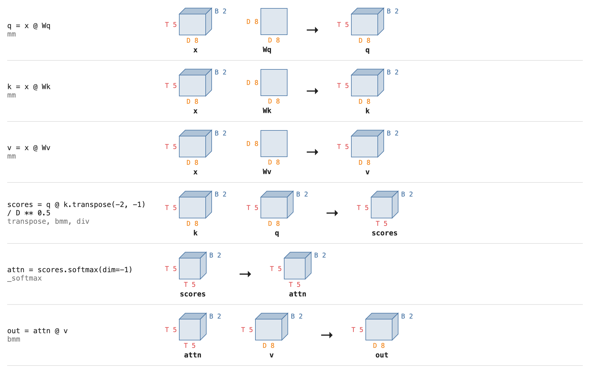
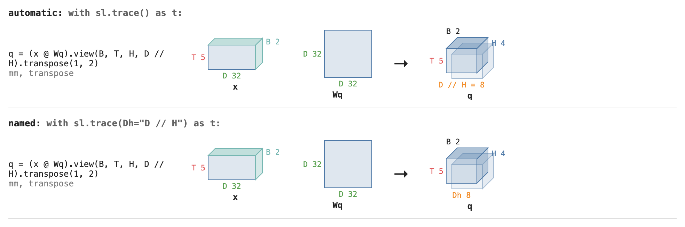
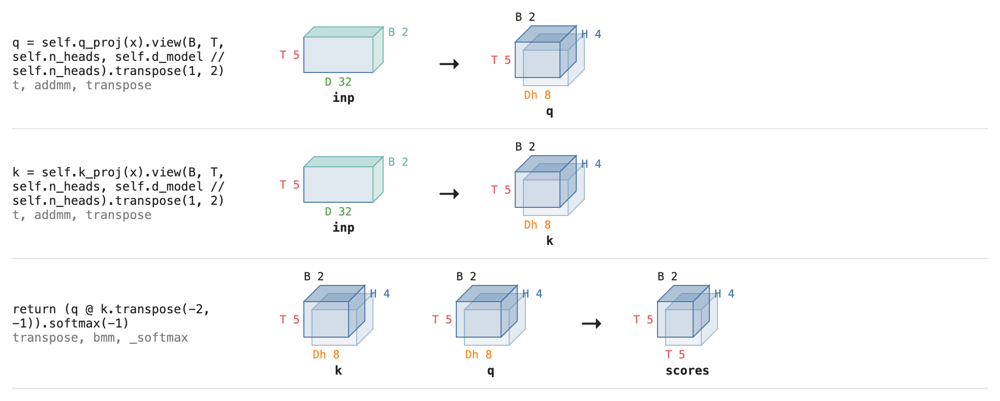

# shapelens

Visualise Pytorch tensor dimensions at ease in Jupyter notebook.


*A ViT patch embedding, traced: image `(B, C, H, W)` becomes tokens `(B, N+1, D)`.*

Built for Jupyter notebooks. In a cell:

```python
import shapelens as sl

with sl.trace() as t:
    out = attention(x, Wq, Wk, Wv, H=4)
t   # last expression in the cell renders the boxes inline
```

- **Shape errors:** if an op fails inside the block, the trace is displayed immediately with the
  failing line highlighted in red, then the original error still propagates.
- `print(t)` gives a plain-text version of the same trace.


## Example: self-attention

```python
import torch
import shapelens as sl

B, T, D = 2, 5, 8                         # batch, tokens, embedding dim
x  = torch.randn(B, T, D, device="meta")  # meta: shapes only, no compute
Wq = torch.randn(D, D, device="meta")
Wk = torch.randn(D, D, device="meta")
Wv = torch.randn(D, D, device="meta")

with sl.trace() as t:
    q = x @ Wq
    k = x @ Wk
    v = x @ Wv
    scores = q @ k.transpose(-2, -1) / D ** 0.5   # every token against every token: (B, T, T)
    attn = scores.softmax(dim=-1)
    out = attn @ v                                # weighted sum of values: (B, T, D)
t   # in a notebook this renders boxes; print(t) gives the text below
```



```
q = x @ Wq
    mm: x[B 2, T 5, D 8], Wq[D 8, D 8] -> q[B 2, T 5, D 8]
scores = q @ k.transpose(-2, -1) / D ** 0.5   # every token against every token: (B, T, T)
    transpose, bmm, div: k[B 2, T 5, D 8], q[B 2, T 5, D 8] -> scores[B 2, T 5, T 5]
attn = scores.softmax(dim=-1)
    _softmax: scores[B 2, T 5, T 5] -> attn[B 2, T 5, T 5]
out = attn @ v                                # weighted sum of values: (B, T, D)
    bmm: attn[B 2, T 5, T 5], v[B 2, T 5, D 8] -> out[B 2, T 5, D 8]
```

(The `k` and `v` projections are traced the same way as `q` and omitted here.) Note how `T 5` becomes
`T 5 × T 5` in `scores`, then collapses back to `D 8` in `out`.

## Dimension labels

Sizes are named from your code automatically:

- **UPPERCASE `int` variables** (`B = 2`, `D = 32`) label every dim of that size: `B 2`, `D 32`.
- **Integer arithmetic** on a traced line names its result by the expression itself. In
  `.view(B, T, H, D // H)` the head dim shows as `D // H = 8`.

To give an expression a short name, pass it with its **exact code**. No hard-coded number is needed:

```python
with sl.trace(Dh="D // H") as t:          # "Dh" names whatever `D // H` is in the code below
    out = attention(x, Wq, Wk, Wv, H=4)   # q: [B 2, H 4, T 5, Dh 8]
```



Copy **any** expression straight from your code. Attributes, subscripts, `/` and function calls all work, and
so does a statement split over several lines. In a module the sizes live on `self`, so there are no `D` or `H`
variables to pick up; name the expressions instead (others that work: `"x.shape[-1] // heads"`, `"D / H"`,
`"len(tokens)"`):

```python
class MultiHeadScores(torch.nn.Module):
    def __init__(self, d_model, n_heads):
        super().__init__()
        self.d_model, self.n_heads = d_model, n_heads
        self.q_proj = torch.nn.Linear(d_model, d_model, device="meta")
        self.k_proj = torch.nn.Linear(d_model, d_model, device="meta")

    def forward(self, x):
        B, T, _ = x.shape
        q = self.q_proj(x).view(B, T, self.n_heads, self.d_model // self.n_heads).transpose(1, 2)
        k = self.k_proj(x).view(B, T, self.n_heads, self.d_model // self.n_heads).transpose(1, 2)
        return (q @ k.transpose(-2, -1)).softmax(-1)

model = MultiHeadScores(d_model=32, n_heads=4)
inp = torch.randn(2, 5, 32, device="meta")

# the names on the left, the exact code on the right
with sl.trace(D="self.d_model", H="self.n_heads", Dh="self.d_model // self.n_heads") as t:
    scores = model(inp)
t
```



A size with no variable or expression of its own can be named by value: `sl.trace(S=197)`.

**Priority**, highest first: names you pass, then the expression text, then variable names. The expression is
evaluated where that line actually runs, so it beats a leftover variable of the same size (say `D = 8` from an
earlier notebook cell), and a name you pass beats both.

**Warnings.** If a name you pass can't be applied you are told why: either the expression was *not found* in
the traced code (usually a typo; spacing doesn't matter), or it was found but *could not be evaluated*, with the
reason (for example it evaluated to a tensor, not an int).

**Limits**
- Labels go by size, so equal sizes show every name (`H/W`), and any other axis of the same size gets the same
  label.
- Automatic expression labels (the `D // H = 8` you get without passing anything) cover only integer arithmetic
  (`+ - * // % **`) on plain variables, evaluated by a small whitelist-only evaluator. Your code is never executed
  for them.
- An expression **you name** is different: it is evaluated with Python's `eval` in the scope of that line, like
  a debugger watch expression. Use pure expressions (no function calls with side effects, such as `next(it)`).

## Tip

Use `device="meta"` tensors to see shapes without any compute or memory.

