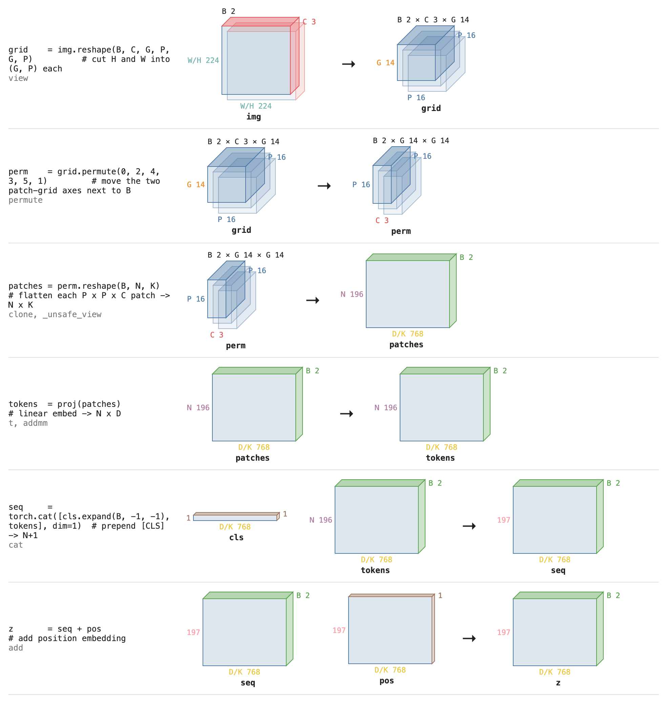
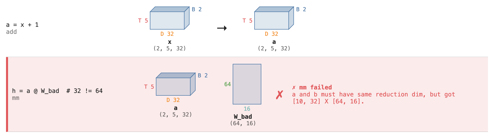

# shapelens

Visualise Pytorch tensor dimensions at ease in Jupyter notebook.



*A ViT patch embedding, traced: image `(B, C, H, W)` becomes tokens `(B, N+1, D)`.*

Built for Jupyter notebooks. In a cell:

```python
import shapelens as sl

with sl.Trace() as t:
    out = attention(x, Wq, Wk, Wv, H=4)
t   # last expression in the cell renders the boxes inline
```

- **Shape errors:** if an op fails inside the block, the trace is displayed immediately with the
  failing line highlighted in red, then the original error still propagates.
- `print(t)` gives a plain-text version of the same trace.



## Dimension labels

Any UPPERCASE `int` variable in your code (`B = 2`, `D = 32`) labels every dim of that size.
Add more by hand: `sl.Trace(S=197)`. Labels go by size, so equal sizes show every name (`H/W`).

## Tip

Use `device="meta"` tensors to see shapes without any compute or memory.

